# SteelPlan

Application web de conception de charpente métallique pour le bureau d'études. On décrit le bâtiment par ses paramètres, et SteelPlan en tire la maquette 3D, les vérifications Eurocode, le dossier de plans jusqu'aux plans d'atelier de chaque poste, les nomenclatures et le chiffrage.

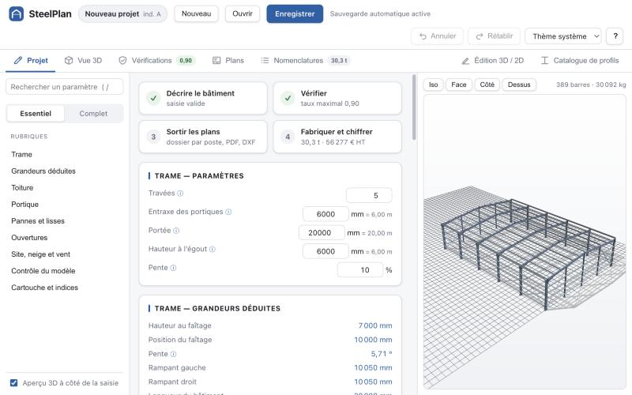

Les paramètres du projet sont la seule source de vérité. Tout le reste est recalculé à chaque modification valide : maquette, rapport de vérification, planches, nomenclatures et fichiers machine. Ces éléments ne peuvent donc pas diverger entre eux. Tant qu'une saisie comporte une erreur, les vues restent sur le dernier état valide, et un bandeau le signale avec un lien vers la rubrique à corriger. Les perçages, les soudures et les boulons ne se saisissent pas : ils sont déduits des pièces posées.

## Le parcours

| Étape | Onglet | Ce qu'elle produit |
|---|---|---|
| 1. Décrire le bâtiment | Projet | La maquette 3D complète : barres coupées, jarrets, tôles percées, boulons, cordons de soudure, repères de débit et d'assemblage. Les erreurs de saisie sont listées et renvoient à la rubrique à corriger. |
| 2. Vérifier | Vérifications | Le verdict, puis le taux de travail de chaque repère et de chaque assemblage avec la combinaison qui le produit, les combinaisons examinées et les hypothèses de calcul. Le dimensionnement automatique se lance depuis cet onglet. |
| 3. Sortir les plans | Plans | Le dossier d'exécution complet et numéroté, ou le dossier d'un poste d'atelier ou de chantier avec son bordereau d'envoi. Exports PDF et DXF ; le perçage reçoit en plus son lot DSTV et la tôlerie ses DXF de découpe. La descente de charges aux appuis figure sur le plan d'implantation des tiges d'ancrage. |
| 4. Fabriquer et chiffrer | Nomenclatures | Listes de débit, de tôles, de boulonnerie et de soudures, colisage, synthèse (tonnage, m² à peindre, kg/m²) et chiffrage HT. Export CSV de chaque liste, lot DSTV et lot de DXF de découpe des tôles. |

Le parcours affiché en tête de l'onglet Projet résume l'avancement : erreurs de saisie, taux maximal ou nombre d'éléments à reprendre, tonnage et prix HT. Un clic sur une étape ouvre l'onglet correspondant.

## Fonctionnalités

### Saisie et modèle

- **Trame** : nombre de travées, entraxe des portiques, portée, hauteur à l'égout. Toiture bipente ou monopente, pente en % ou en degrés, versants dissymétriques possibles.
- **Structure porteuse**, au choix :
  - portique à âme pleine : jarret de genou, renfort de faîtage en option, pieds articulés ou encastrés, portique de pignon distinct possible ;
  - ferme treillis Warren, Pratt, Howe ou Polonceau : entrait droit ou retroussé, doubles cornières dos à dos possibles.
- **Ossature secondaire** :
  - pannes, réparties par entraxe ou par nombre, avec sablière, faîtière, et débord d'égout porté par une console ;
  - liernes ;
  - lisses de long pan et de pignon ;
  - potelets de pignon à trous oblongs en tête.
- **Contreventements** : poutre au vent, palées de stabilité et contreventement de pignon. Chacun peut être en croix de Saint-André, en diagonale simple ou en K, sur les travées choisies.
- **Ouvertures de façade** (portail, porte, châssis), encadrées automatiquement par un chevêtre. Une ouverture impossible est refusée avec sa raison.
- **Assemblages générés** : platines d'about de genou et de faîtage, consoles, pieds de poteau et de potelet avec tiges d'ancrage, goussets de treillis, éclisses, attaches de contreventement par tube fendu, échantignolles, attaches de lisses et de chevêtres. Une même grille de boulons sert à la tôle, au perçage du porteur et au calcul ; elle évite les semelles.
- **Repérage automatique** de débit (17 préfixes de barres : PO, TR, PA, LI… et 8 de tôles : PL, PP, GO…) puis d'assemblage. Le repère d'assemblage prend une lettre (TR1A, TR1B) quand les pièces soudées diffèrent.
- **Catalogue de 419 profils européens en 15 familles** : IPE, HEA, HEB, HEM, UPN, UPE, cornières égales et inégales, CHS, SHS, RHS, plats, ronds, Z et C formés à froid. Nuances S235, S275, S355, S420 et S460.
- **Cinq gabarits de départ** : projet vierge, hangar agricole, bâtiment industriel, ferme treillis en doubles cornières, auvent monopente.
- **Validation avant génération** : les erreurs bloquent, les avertissements laissent passer. Exemples : pinces sous les minima de l'EN 1993-1-8, tiges d'ancrage hors du poteau, bâtiment de plus de 100 m sans joint.
- **Barres libres** (bracons, potences, poutres de reprise) : ajoutées à la main et dupliquables en série.

Pour fixer les ordres de grandeur, le gabarit « Projet vierge » (20 × 30 m) génère 389 barres, 12 jarrets, 156 tôles, 888 boulons et 60 tiges d'ancrage, et 406 cordons (172,6 m). Cela représente 40 repères, 30,09 t et 879 m² de barres à peindre (899 m² tôles comprises, chiffre de la Vue 3D).

### Calcul et vérifications

- **Charges climatiques** : neige et vent sont déduits du site (région, altitude, catégorie de terrain) selon la NF EN 1991-1-3/NA et la NF EN 1991-1-4/NA. Le calcul donne sk, la neige accidentelle, qp(z), les cpe par zones de parois et de toiture, et applique cpi = +0,2 / −0,3. Les charges peuvent aussi être saisies à la main.
- **Combinaisons EN 1990** générées automatiquement :
  - ELU fondamentales (6.10) ;
  - soulèvement avec poids propre favorable ;
  - ELU accidentel ;
  - ELS caractéristiques ;
  - neige dissymétrique sur toiture bipente ;
  - huit cas de vent par zones.
- **Analyse** : le portique courant et le portique de rive sont extraits de la maquette 3D et calculés par un solveur plan (méthode des rigidités). L'imperfection d'aplomb est ajoutée ; la sensibilité au second ordre est contrôlée par αcr, avec amplification si nécessaire.
- **Barres, selon l'EN 1993-1-1** : classe de section, résistance, cisaillement, flambement, déversement, interaction N + M, flèches et déplacements en tête, élancement de bonne pratique.
- **Ossature secondaire** :
  - pannes et lisses formées à froid selon l'EN 1993-1-3 : section efficace, distorsion, semelle libre comprimée ;
  - pannes, lisses, potelets, contreventements et liernes calculés analytiquement.
- **Assemblages, selon l'EN 1993-1-8** :
  - platines d'about de genou et de faîtage (tronçon en T) ;
  - pied de poteau ;
  - attaches des diagonales de contreventement (tube fendu sur gousset) ;
  - têtes de potelets à oblongs, dont la course est comparée à la flèche de la traverse.
- **Descente de charges** par appui (A1, B3…) : compression, soulèvement, effort horizontal et moment, avec la combinaison qui produit chaque valeur.
- **Dimensionnement automatique** (onglet Vérifications ou assistant) : poste par poste, le logiciel cherche le profil le plus léger qui tient. En option, il change de famille et règle les assemblages. Il présente ensuite une proposition, appliquée d'un clic et annulable d'un seul Ctrl+Z. Le calcul tourne en tâche de fond (Web Worker), avec suivi de l'avancement, et peut être interrompu.
- **Rapport** : une ligne par pièce, qui garde le pire de chaque critère. Les hypothèses sont rédigées avec les valeurs réelles. Les pièces non vérifiées sont nommées avec leur raison.

### Plans d'atelier par poste

- **Dossier toujours à jour** : il est recalculé à chaque modification, cotes comprises, et numéroté « n/N » au cartouche.
- **Plans d'ensemble** : vue en plan avec traits de coupe, élévations, quatre façades vues de l'extérieur, coupes, et détails des nœuds réellement présents dans le modèle.
- **Chantier** : plans de repérage, ordre de montage en cinq phases, plan d'implantation des tiges d'ancrage avec la descente de charges, pour le génie civil.
- **Atelier**, dans l'ordre de fabrication :
  1. commande matière ;
  2. calepinage de débit ;
  3. plan de pièce (débit et perçage) pour chaque repère ;
  4. imbrication des tôles et tôles à plat cotées ;
  5. plans d'assemblage avec symboles de soudure ;
  6. gammes de fabrication ;
  7. bon de traitement de surface ;
  8. fiche de contrôle avant expédition ;
  9. bordereaux d'expédition par colis.
- **Nomenclatures et note de pré-dimensionnement** intégrées au dossier, au même indice que les plans.
- **11 postes** : bureau d'études, approvisionnement, débit, perçage, tôlerie, assemblage et soudage, traitement de surface, contrôle, expédition, montage, génie civil. L'onglet Plans demande d'abord quel dossier sortir. Chaque poste reçoit un bordereau d'envoi, puis ses planches avec leur numéro dans le dossier complet. Le perçage reçoit en plus son lot DSTV et la tôlerie ses DXF de découpe, annoncés sur le bordereau.
- **Mise en page normalisée** : cadre ISO 5457, cartouche avec tableau des indices de révision, échelles ISO 5455, traits ISO 128, symboles de soudure NF EN ISO 2553.
- **Retouches manuelles** du dessinateur conservées à chaque régénération. Une retouche dont l'entité d'origine a changé est signalée « à revoir » ; elle n'est ni appliquée ni perdue en silence.

### Nomenclatures et chiffrage

- **Listes** :
  - débit par repère : longueurs à l'axe et maxi, angles de coupe, perçages, masses, surface à peindre ;
  - tôles ;
  - boulonnerie, avec une longueur calculée d'après le serrage réel ;
  - soudures ;
  - synthèse : masse par nuance, m² à peindre, ratio kg/m².
- **Calepinage** dans les longueurs du commerce, en tenant compte du trait de scie, des tombées et des chutes réutilisables.
- **Imbrication** des tôles dans le format du commerce choisi (3 000 × 1 500 mm par défaut).
- **Colisage** dans l'ordre du montage ; les pièces hors gabarit sont listées à part.
- **Chiffrage** par une grille de prix enregistrée avec le projet. Postes : acier par nuance, main-d'œuvre par pièce, soudure au mètre, peinture ou galvanisation au m², boulonnerie, transport, montage, frais généraux, aléas, marge.
  - La grille de l'entreprise est mémorisée sur le poste de travail et reprise par chaque nouveau projet.
  - Transport, montage, frais généraux, aléas et marge laissés à zéro sont nommés « non chiffrés » ; la fourniture et l'atelier sont toujours chiffrés.
- **Export CSV** de chaque nomenclature au format français : point-virgule, virgule décimale, UTF-8 avec BOM.

### Échanges et formats

| Format | Sens | Usage |
|---|---|---|
| `.steelplan` (JSON) | lecture / écriture | Fichier projet versionné (format 5) avec migration des anciens fichiers. Il est relu comme une entrée non fiable : types et valeurs contrôlés, 5 Mo au plus, plafonds sur les paramètres |
| PDF vectoriel | export | Dossier complet, dossier d'un poste ou planche seule, en mm à l'échelle 1 |
| DXF R12 | export | Une planche par fichier |
| DXF de découpe (ZIP) | export | Un fichier par repère de tôle (calques DECOUPE / PERCAGE / MARQUAGE), pour l'oxycoupage ou le plasma |
| DSTV NC1 (ZIP) | export | Un fichier `.nc1` par repère de débit, pour les perceuses-scies à commande numérique |
| IFC4 | export | Maquette BIM (barres, tôles, boulons, assemblages), avec des identifiants stables d'un indice à l'autre |
| CSV | export | Nomenclatures et chiffrage |

### Interface

- **Sept onglets** dans l'ordre du travail : Projet, Vue 3D, Vérifications, Plans, Nomenclatures, puis deux outils, Édition 3D / 2D et Catalogue de profils. Touches 1 à 7, pastilles d'état sur les onglets.
- **Création d'un projet** : assistant en cinq étapes (bâtiment, dimensions, ossature, charges, récapitulatif), avec dimensionnement automatique des profils en option. On peut aussi partir d'un gabarit.
- **Onglet Projet** : affichage Essentiel (par défaut : trame, toiture, portique, pannes et lisses, ouvertures, site, contrôle, cartouche) ou Complet, qui ajoute contreventements, assemblages, charges et flèches, traitement de surface, atelier, chiffrage, barres libres et fichier projet. Une rubrique en anomalie reste toujours visible. Sommaire des rubriques avec compteurs d'erreurs, recherche de paramètre (touche `/`), aide intégrée sur les termes techniques, aperçu 3D à côté de la saisie.
- **Vue 3D** (Three.js) :
  - vues normalisées ;
  - cinq modes de couleurs : réaliste, par type, par profil, par taux de travail, uniforme ;
  - coupe dynamique, mesure, isolement d'un repère, masquage ;
  - fiche de débit de la pièce sélectionnée ;
  - export IFC.
- **Édition 3D / 2D** :
  - sélection d'une pièce : le profil d'une pièce générée se change pour tout son poste, et assemblages, calculs et plans suivent ;
  - ajout de barres libres par accrochage (extrémités et milieux des barres) ou par coordonnées, en chaîne ; chaque barre ajoutée se règle, se duplique ou se supprime ;
  - retouche des planches avec une ligne de commande de type DAO (ligne, polyligne, cercle, cote, décaler, ajuster, prolonger…, alias français et anglais), avec accrochage, ortho et calques ;
  - depuis une pièce en 3D, « Voir en 2D » ouvre les planches où elle figure.
- **Historique** : annuler / rétablir sans limite.
- **Raccourcis** : Ctrl+N, Ctrl+O, Ctrl+S, Ctrl+Maj+S ; Ctrl+Z / Ctrl+Maj+Z ; 1 à 7 pour les onglets ; `/` pour la recherche ; I, F, C, D et R pour les vues 3D ; F3 et F8 (accrochage, ortho) dans l'éditeur 2D. ⌘ remplace Ctrl sur Mac. Maj+? affiche la liste.
- **Thème** clair, sombre ou celui du système.
- **Sauvegarde** dans un fichier `.steelplan`, plus une sauvegarde automatique dans le navigateur ; la restauration est proposée au démarrage.

## Captures

<table>
<tr>
<td width="50%"><br><sub><b>Projet</b> : parcours, saisie par rubriques et aperçu 3D</sub></td>
<td width="50%">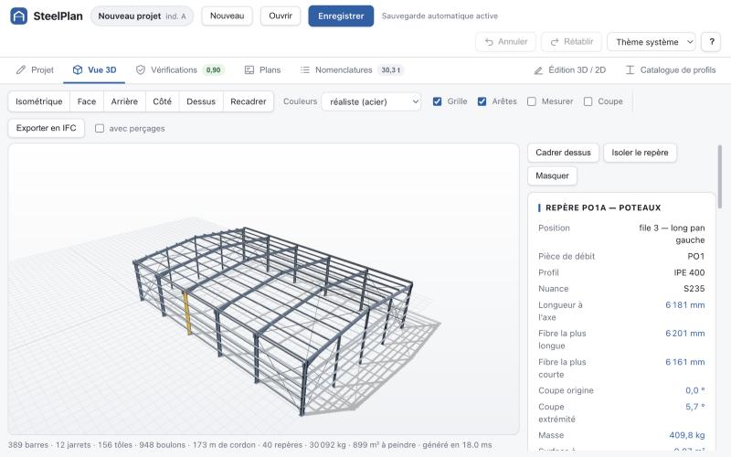<br><sub><b>Vue 3D</b> : rendu réaliste et fiche de la pièce sélectionnée</sub></td>
</tr>
<tr>
<td width="50%">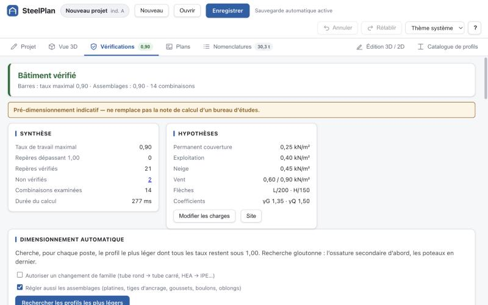<br><sub><b>Vérifications</b> : verdict et taux de travail</sub></td>
<td width="50%">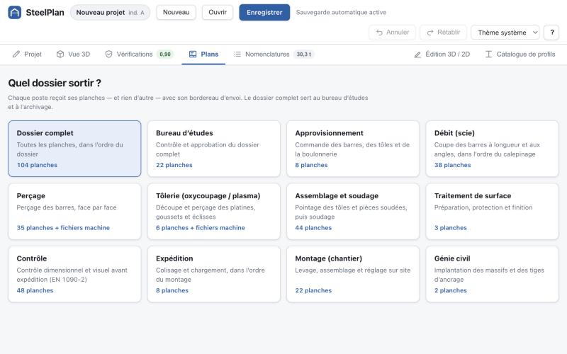<br><sub><b>Plans</b> : choix du dossier par poste d'atelier</sub></td>
</tr>
<tr>
<td width="50%">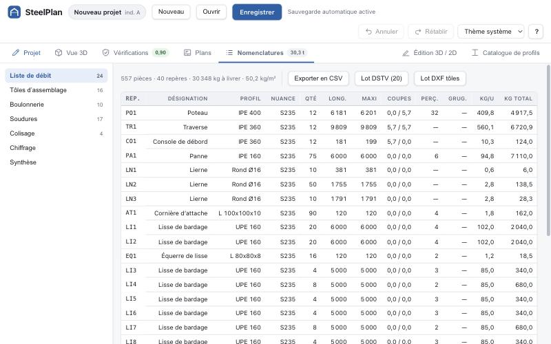<br><sub><b>Nomenclatures</b> : liste de débit, exports CSV, DSTV et DXF</sub></td>
<td width="50%">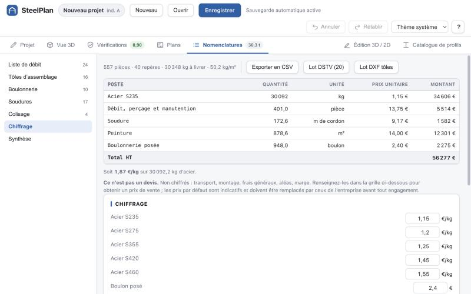<br><sub><b>Chiffrage</b> : grille de prix modifiable, total HT</sub></td>
</tr>
<tr>
<td width="50%">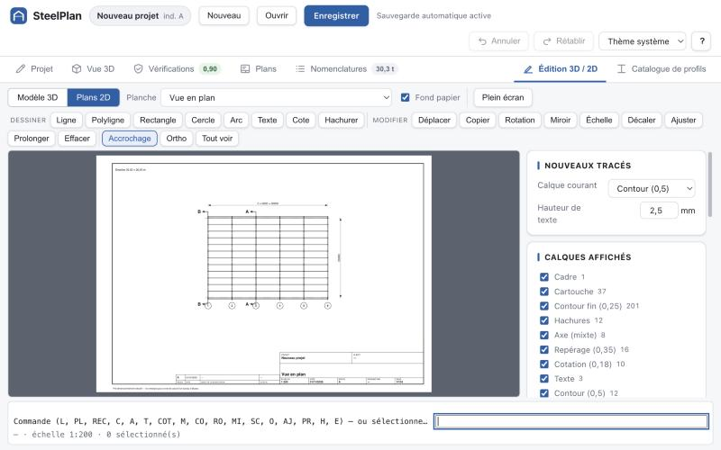<br><sub><b>Édition 2D</b> : retouche des planches, ligne de commande de type DAO</sub></td>
<td width="50%">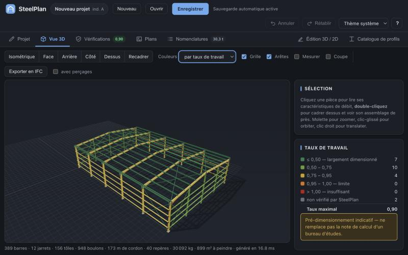<br><sub><b>Thème sombre</b> : vue 3D colorée par taux de travail</sub></td>
</tr>
</table>

### Planches générées

Trois planches du dossier du gabarit « Projet vierge », telles que SteelPlan les produit : elles sont vectorielles et à l'échelle.

<p>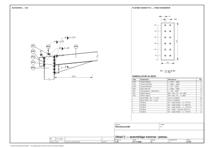<br><sub><b>Détail C</b> : assemblage traverse / poteau au 1:20, avec platine d'about en vraie grandeur, symboles de soudure et nomenclature du nœud</sub></p>

<p>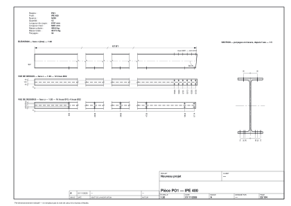<br><sub><b>Pièce PO1</b> : plan de débit et perçage d'un poteau IPE 400, face par face, avec les cotes cumulées des trous</sub></p>

<p>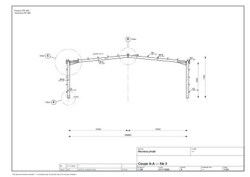<br><sub><b>Coupe A-A</b> : portique courant de la file 3</sub></p>

## Démarrage

**Prérequis** : Node.js 18, ou 20 et plus (Vite 5 et Vitest 2 excluent Node 19), avec npm. L'application tourne entièrement dans le navigateur : il n'y a ni serveur ni compte.

```bash
npm install
npm run dev        # serveur de développement Vite, http://localhost:5173 par défaut
```

| Commande | Effet |
|---|---|
| `npm run dev` | Serveur de développement (Vite) |
| `npm run build` | Contrôle des types (`tsc --noEmit`) puis build de production dans `dist/` |
| `npm run preview` | Sert le build de production en local |
| `npm test` | Lance les tests une fois (`vitest run`) |
| `npm run test:watch` | Lance les tests en mode surveillance |
| `npm run typecheck` | Contrôle des types seul (`tsc --noEmit`) |

**Enregistrement** : si le navigateur expose l'API File System Access (navigateurs Chromium), Ctrl+S réenregistre dans le même fichier. Sinon, chaque enregistrement télécharge un nouveau fichier.

**Pile technique** : TypeScript en mode strict, React 18, Three.js, zustand et immer pour l'état, jsPDF, Vite, Vitest.

## Architecture

Le flux de données est le suivant :

```
ProjectParams ──buildProject──▶ StructuralModel ──▶ vérifications, dossier de plans, nomenclatures ──▶ écran et exports
(paramètres saisis)              (maquette 3D)
```

```
src/
├── main.tsx, App.tsx    point d'entrée React : onglets, raccourcis, thème
├── core/                cœur métier, TypeScript pur
│   ├── model/           ProjectParams : trame, toiture, portique, ferme, secondaire, contreventements,
│   │                    ouvertures, assemblages, site, charges, finition, atelier, prix ; gabarits ; validation
│   ├── catalog/         profils européens et nuances d'acier
│   ├── geometry/        contour de section, barres et plans de coupe, perçages, soudures, grugeages
│   ├── build/           buildProject : portiques, fermes, secondaire (secondaire/), contreventements,
│   │                    assemblages (connections/), boulonnerie, repérage
│   ├── climat/          neige et vent déduits du site (EN 1991-1-3, EN 1991-1-4 et annexes nationales)
│   ├── analysis/        combinaisons EN 1990, modèle de portique extrait de la 3D, solveur plan, second ordre
│   ├── checks/          vérifications EN 1993-1-1, 1-3 et 1-8 (assemblages/), descente de charges,
│   │                    dimensionnement automatique et son Web Worker
│   ├── drawing/         dossier de plans : planches (sheets/), cartouche, échelles, cotation, postes, retouches
│   ├── bom/             nomenclatures, calepinage, imbrication, colisage, chiffrage, CSV
│   ├── io/              fichier .steelplan, migrations, sauvegarde automatique, grille de prix de l'entreprise
│   └── math/            vecteurs 3D, tolérances, convention d'unités
├── export/              PDF (jsPDF), DXF des planches, DXF de découpe, DSTV, ZIP, IFC4 (ifc/)
├── render2d/            traduction d'une planche en SVG pour l'écran
├── render3d/            scène Three.js : maillages, cordons de soudure, couleurs, cadrage, pointage
├── state/               store zustand avec historique par patches immer, état dérivé, navigation, affichage
└── ui/                  panneaux des onglets, assistant, saisie, vue 3D, édition, éditeur 2D, thème CSS
```

`src/core` n'importe ni React, ni Three.js, ni zustand, ni jsPDF, ni aucun module de `ui/`, `state/`, `render2d/`, `render3d/` ou `export/`. Seuls des tests y font exception. Le calcul, la génération du modèle, les plans et les nomenclatures ne dépendent donc d'aucune bibliothèque d'interface. Ce sont des fonctions déterministes, hors temps de calcul mesurés et date du jour, testées sous Node sans navigateur. Trois modules touchent au navigateur :

- `core/io/storage.ts` accède au `localStorage`, avec un repli s'il est indisponible ;
- `core/io/grilleEntreprise.ts` garde la grille de prix de l'entreprise, en passant par `storage.ts` ;
- `core/checks/dimensionner.worker.ts` est le point d'entrée du Web Worker de dimensionnement.

Chaque planche est décrite une seule fois, en mm papier. Trois moteurs la traduisent : SVG pour l'écran, PDF et DXF. Le solveur et la géométrie travaillent en mm, N et N·mm. Les charges surfaciques, saisies ou déduites du site, sont en kN/m² (arrondies à 0,01 kN/m²) ; la descente de charges est en kN et kN·m. Les autres arrondis sont réservés à l'affichage.

## Tests

Les tests (Vitest) sont rangés dans des dossiers `__tests__` à côté des modules et s'exécutent sous Node. Ils couvrent :

- **le calcul** : solveur de portique, second ordre, neige et vent par zones, vérifications de barres et d'assemblages, profils formés à froid, réactions d'appui, dimensionnement automatique des profils et des assemblages ;
- **le modèle** :
  - génération des portiques, fermes (et leur stabilité), ossature secondaire, contreventements, ouvertures et assemblages ;
  - comptage des boulons ;
  - invariants géométriques : aucun perçage dans le vide, pinces minimales respectées, aucune pièce enfoncée dans une autre ;
  - gabarits, qui doivent tous sortir vérifiés du calcul ;
- **les plans** : cartouche, cotation, élévations, façades, plans de fabrication, montage, repérage, diffusion par poste, retouches, géométrie et opérations 2D, translittération des textes ;
- **les nomenclatures** : listes, calepinage, imbrication, et conservation de la masse entre le modèle, la nomenclature et la livraison (contrôlée sur le projet par défaut) ;
- **les fichiers** : sérialisation et migrations, relecture de fichiers forgés (valeurs hors liste, clés d'`Object.prototype`, plafonds), sauvegarde automatique, grille de prix, et les exports DSTV (dont l'injection de texte dans l'en-tête), DXF de tôles, IFC (structure STEP, identifiants), contenu PDF et ZIP, ainsi que la tenue en charge de l'export d'un dossier complet ;
- **le rendu et l'état** : cadrage et maillage 3D, cordons de soudure, historique d'annulation, état dérivé ;
- **la logique de l'interface** : raccourcis, commandes de l'éditeur 2D, rubriques, aide, garde-fou. Le rendu des composants n'est pas testé.

## Limites

SteelPlan est un outil de **pré-dimensionnement indicatif**. Chaque planche porte la mention « Pré-dimensionnement indicatif — ne remplace pas la note de calcul d'un bureau d'études ».

**Calcul**

- Le calcul est élastique au premier ordre. Si αcr < 3, l'analyse au second ordre complète n'est pas faite : le cas est signalé et les longueurs de flambement restent forfaitaires.
- L'amplification 1/(1 − 1/αcr) est appliquée à tous les efforts dès que αcr < 10, y compris entre 1 et 3, où elle n'a plus de validité normative.
- Le portique est analysé dans son plan uniquement : Mz,Ed = 0 pour ses barres.
- L'interaction N + M est une somme linéaire, au lieu des facteurs kyy/kyz du § 6.3.3. Pour Mcr, C1 = 1,0 ; It et Iw sont approchés.
- La semelle comprimée est supposée maintenue par les pannes ou les lisses. Près du jarret et sous soulèvement, le bracon nécessaire n'est pas modélisé. L'inertie des jarrets est négligée.
- Les sections laminées de classe 4 ne sont pas couvertes : elles sont signalées et le dimensionnement ne les propose jamais.
- Profils formés à froid : ne sont pas couverts l'interaction N + M (§ 6.1.9), la flexion latérale de la semelle libre (§ 10.1.4.2, omission non conservative), la résistance aux charges locales sur appui (§ 6.1.7) ni la continuité par emboîtement des Z. Seule la flexion d'axe fort est calculée, la panne étant supposée maintenue par le bac (§ 10.1). Les dimensions des Z et C sont représentatives ; ce n'est pas le catalogue d'un fabricant.
- Vent : le logiciel utilise les cpe,10 recommandés, sans les valeurs du tableau 7.4a modifiées par l'annexe nationale française, avec co = cdir = csaison = 1 et kI = 1 (coefficient de turbulence de l'annexe nationale non appliqué, du côté de la sécurité). En saisie manuelle, le vent n'est pas zoné.
- Neige : ce = ct = 1, sans accumulation ni congère.
- Contreventements : les efforts suivent un cheminement simplifié, sans raideur relative des palées.
- Le dimensionnement automatique est glouton : ce n'est pas un optimum global. Les profils de pignon distincts ne sont pas dimensionnés automatiquement.
- Les barres libres ne sont pas vérifiées, car leur rôle statique est inconnu.

**Assemblages**

- Le genou et le faîtage sont tirés du seul portique courant : un seul détail vaut pour tous.
- Platine d'about : ne sont pas couverts le panneau d'âme du poteau, la flexion de sa semelle ni les raidisseurs.
- Pied de poteau : seul le pied le plus comprimé est vérifié. La bêche n'est pas calculée. L'ancrage dans le béton (EN 1992-4) et la fondation ne sont pas couverts.
- Attaches de diagonales : ne sont pas couverts le cisaillement de bloc, le flambement du gousset, le traînage de cisaillement du tube fendu ni l'excentrement du recouvrement simple.
- Têtes de potelets : ne sont pas couvertes la flexion de l'âme du potelet ni celle du gousset ; les oblongs sont supposés ne transmettre aucun effort vertical.
- Les goussets de treillis, éclisses, échantignolles et attaches de lisses ne sont pas vérifiés.

**Modèle**

- Aucun joint de dilatation n'est modélisé : un simple avertissement apparaît au-delà de 100 m.
- Les grugeages sont prévus dans le format mais ne sont pas encore générés.
- Ouvertures : la menuiserie n'est pas traitée, ni les percements de toiture. Les chevêtres ne sont encore ni colisés ni portés à l'ordre de montage.

**Fichiers et chiffrage**

- DSTV : aucun fichier n'a encore été lu par une machine réelle. Faites percer et mesurer une pièce avant toute série. Sont exportés les profils I, U, L, CHS, caissons et plats (ces derniers sous le code M, à valider) ; les ronds et les Z et C formés à froid sont écartés et nommés.
- IFC : les barres sont exportées sans leurs perçages par défaut, car certains lecteurs soustraient mal les trous. La maquette n'a qu'un seul niveau.
- DXF R12 : la cotation n'est pas associative ; les cotes et les hachures sont exportées en traits.
- La grille de prix par défaut donne des ordres de grandeur, pas des prix de marché : le chiffrage n'est pas un devis. La surface à peindre des nomenclatures et du chiffrage ne compte pas les tôles ; celle de la Vue 3D les compte.
- Les tolérances de la fiche de contrôle et la consommation du bon de peinture sont des valeurs usuelles, à confirmer par le plan qualité du fabricant et les fiches techniques du fournisseur.
- La sauvegarde automatique est un filet de sécurité, pas un substitut au fichier projet. L'historique d'annulation n'est pas conservé d'une session à l'autre.

Les résultats sont une aide à la conception et doivent être validés par un ingénieur structure responsable.

## Licence

Aucune licence n'est encore définie : le code est consultable, mais tous droits sont réservés.